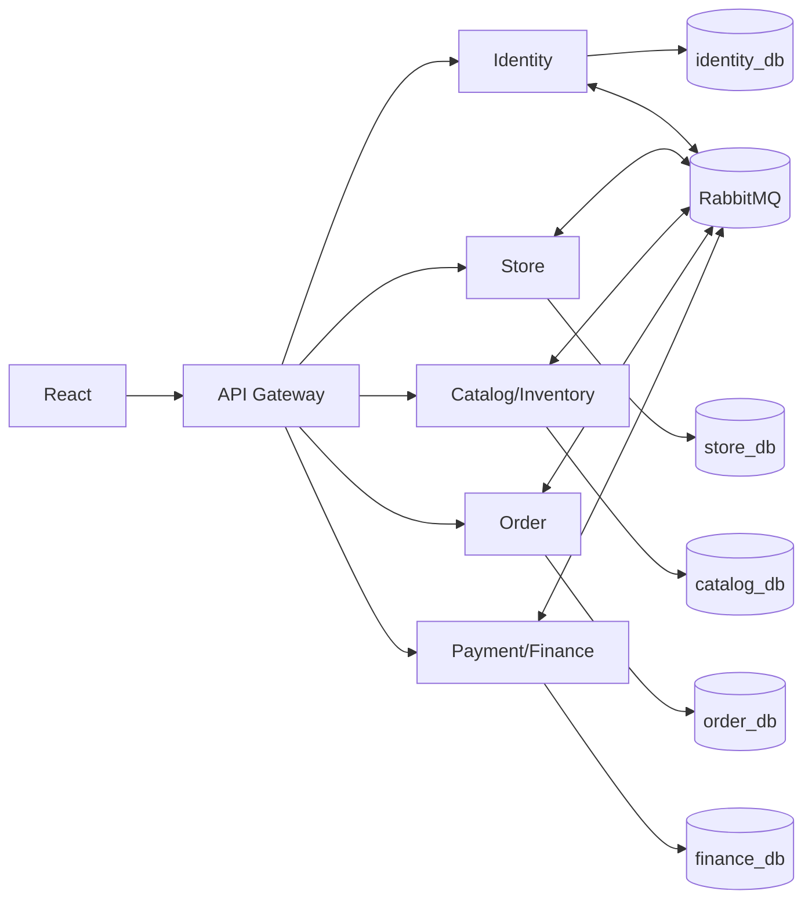
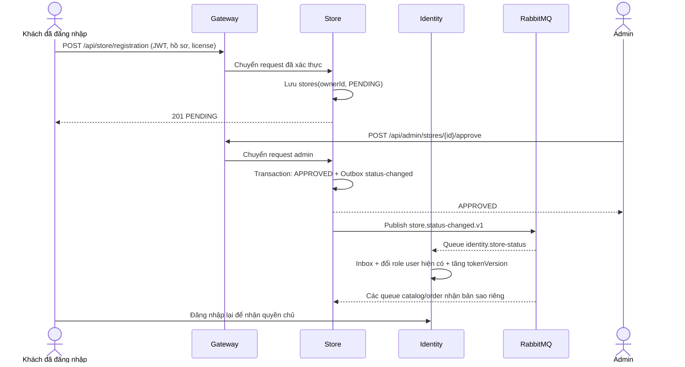
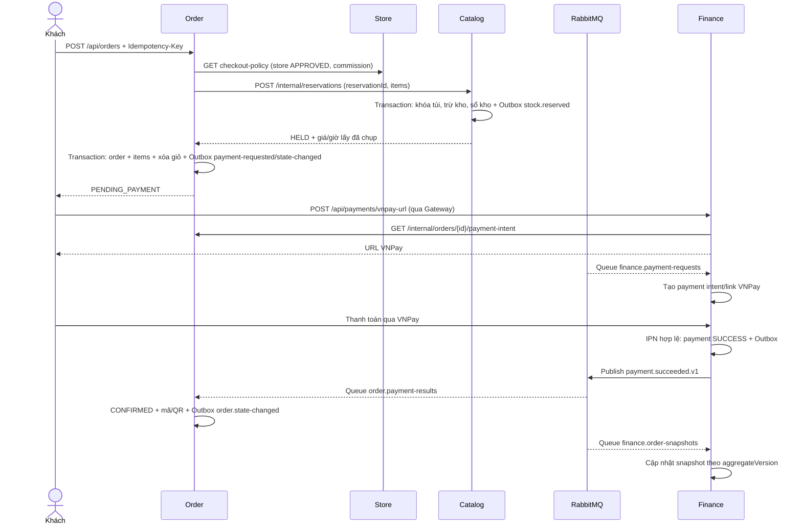
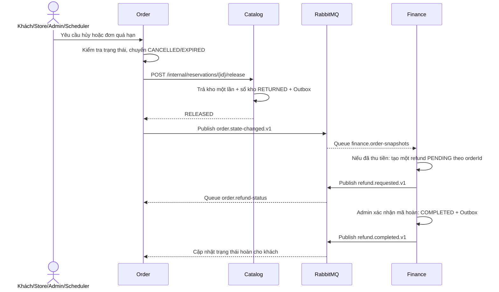

# Tài liệu đồ án FoodRescue: kiến trúc 5 microservices

> Cập nhật: 22/11/2026. Tài liệu này mô tả hệ thống mục tiêu và phần **đã triển khai trong `services/`**. Các mục ghi **Dự kiến** là hợp đồng để nhóm phát triển tiếp, chưa phải API hoặc message đang chạy. Phạm vi tài liệu chỉ gồm năm service nghiệp vụ, API Gateway, React, các DB và RabbitMQ.

## 1. Bài toán và phạm vi

FoodRescue cho khách hàng mua túi thực phẩm cuối ngày tại cửa hàng gần mình. Khách xem túi, thêm giỏ, đặt đơn, thanh toán VNPay và nhận bằng mã/QR. Cửa hàng đăng túi, quản lý kho, giao hàng và theo dõi doanh thu. Admin duyệt cửa hàng, quản lý tài khoản, danh mục, hoàn tiền, chi trả kỳ và đối soát. Tác vụ định kỳ xử lý đơn quá hạn, túi hết giờ và khách không đến lấy.

Năm miền nghiệp vụ có quyền ghi dữ liệu độc lập:

| Service | Trách nhiệm | DB sở hữu | Cổng local | Mức hoàn thành |
|---|---|---|---:|---|
| `identity-service` | Tài khoản, JWT, vai trò, khóa tài khoản, audit | `identity_db` MySQL | 8082 | Auth, hồ sơ, admin user, audit đã có |
| `store-service` | Hồ sơ/duyệt cửa hàng, nhân viên, đánh giá | `store_db` MySQL | 8083 | Schema, entity, publisher; API nghiệp vụ dự kiến |
| `catalog-inventory-service` | Danh mục, túi, sổ kho, giữ/trả kho, tìm gần | `catalog_db` PostgreSQL | 8084 | Giữ/trả kho nội bộ đã có; API công khai dự kiến |
| `order-service` | Giỏ, đơn, mã nhận hàng, hủy/giao, scheduler | `order_db` PostgreSQL | 8085 | Adapter gọi catalog và API nội bộ thử luồng đã có; đơn thật dự kiến |
| `payment-finance-service` | VNPay, refund, doanh thu, payout, dashboard | `finance_db` PostgreSQL | 8086 | Schema, entity, publisher; API nghiệp vụ dự kiến |

`api-gateway` ở cổng 8080 là điểm vào HTTP. `building-blocks` là thư viện kỹ thuật nội bộ, không sở hữu bảng hay nghiệp vụ. Frontend React/Vite ở cổng 5173 chỉ gọi `/api/**` qua Gateway. `/internal/**` chỉ dành cho service gọi service và không mở thành route công khai.



Mỗi service chỉ ghi DB của mình. ID của thực thể thuộc service khác là trường số/UUID tham chiếu, không có foreign key xuyên DB. Giao tiếp cần kết quả ngay dùng API nội bộ có timeout; thay đổi trạng thái lan sang service khác dùng Outbox + RabbitMQ + Inbox.

## 2. Cây thư mục và quy tắc Clean Architecture

```text
foodrescue/
├── services/
│   ├── pom.xml                     # Maven reactor để build cùng lúc
│   ├── building-blocks/            # HTTP client, health, event envelope dùng chung
│   ├── api-gateway/                # Route và GET /api/health
│   ├── identity-service/
│   ├── store-service/
│   ├── catalog-inventory-service/
│   ├── order-service/
│   └── payment-finance-service/
├── frontend/src/
│   ├── auth/                       # AuthProvider, phiên đăng nhập
│   ├── routes/                     # AppRoutes, RouteGuards
│   ├── layouts/                    # AppLayout
│   ├── pages/customer|store|admin/ # Màn hình theo vai trò
│   ├── services/                   # axios và API client theo miền
│   └── components/, constants/, utils/, theme/, styles/
├── contracts/                      # Hợp đồng HTTP, event, quyền sở hữu, schema/ví dụ
├── docker/mysql/init/, docker/postgres/init/
├── docker-compose.yml
├── .env.example
├── scripts/restart-services.ps1    # Mở Docker, 5 service, Gateway, frontend
├── scripts/run-service.ps1
└── scripts/run-frontend.ps1
```

Mỗi service nghiệp vụ là **một Maven project và một Spring Boot JAR**:

```text
<service>/
├── pom.xml, Dockerfile
└── src/main/
    ├── java/com/foodrescue/<service>/
    │   ├── <Service>Application.java
    │   ├── api/                    # Controller, request/response, HTTP error
    │   ├── domain/model/           # Model và quy tắc Java thuần
    │   ├── domain/repository/      # Interface repository nếu cần
    │   ├── application/usecase/    # Điều phối nghiệp vụ
    │   ├── application/port/out/   # Interface cho DB, message, HTTP, transaction
    │   └── infrastructure/
    │       ├── adapter/out/persistence/ # JPA/JDBC, entity, adapter
    │       ├── adapter/out/http/        # Client service khác
    │       ├── messaging/               # RabbitMQ, Outbox/Inbox
    │       ├── security/                # JWT/BCrypt khi cần
    │       └── config/                  # Spring bean wiring
    └── resources/application.yml, db/migration/V*.sql
```

`api → application → domain`; `infrastructure` triển khai các port do application/domain khai báo. Controller không chứa truy vấn SQL. Domain không import Spring/JPA/RabbitMQ. Entity JPA không trả trực tiếp cho frontend. Spring DI dùng constructor injection và `@Bean`/component ở lớp ngoài. Mỗi service chạy Flyway khi khởi động; Hibernate dùng `ddl-auto: validate`, không tự sửa schema.

## 3. DB, bảng và quyền sở hữu

**Năm DB logic** chạy trên **hai container DB**. Số container không bằng số DB. MongoDB có profile `search` tùy chọn, hiện chưa lưu nghiệp vụ và không nằm trong năm DB chính.

| DB | Engine/container | Bảng chính | Dữ liệu chỉ service đó được ghi |
|---|---|---|---|
| `identity_db` | MySQL 8.4, host `localhost:3307` | `users`, `audit_logs`, `outbox_events`, `inbox_events`, `flyway_schema_history` | Email/BCrypt hash, role, `token_version`, audit |
| `store_db` | MySQL 8.4, host `localhost:3307` | `stores`, `reviews`, `outbox_events`, `inbox_events`, `flyway_schema_history` | Hồ sơ, trạng thái duyệt, hoa hồng, tài khoản nhận tiền, đánh giá |
| `catalog_db` | PostgreSQL 17, host `localhost:5433` | `categories`, `rescue_batches`, `stock_movements`, `stock_reservations`, `stock_reservation_items`, `outbox_events`, `inbox_events`, `flyway_schema_history` | Giá/túi hiện hành, số còn lại, sổ kho, reservation |
| `order_db` | PostgreSQL 17, host `localhost:5433` | `cart_items`, `orders`, `order_items`, `outbox_events`, `inbox_events`, `flyway_schema_history` | Giỏ, trạng thái đơn, giá đã chụp, mã nhận hàng |
| `finance_db` | PostgreSQL 17, host `localhost:5433` | `payments`, `refunds`, `payouts`, `payout_items`, `order_snapshots`, `outbox_events`, `inbox_events`, `flyway_schema_history` | Giao dịch, hoàn tiền, kỳ chi trả, bản sao đơn cho đối soát |

Migration hiện có: identity `V1__baseline.sql` và `V2__user_token_version.sql`; bốn service còn lại có `V1__baseline.sql`. Mỗi thay đổi DB sau đó tạo file `V3__...` hoặc `V2__...` trong service sở hữu. Không sửa lại migration đã áp dụng. `stock_movements` và `audit_logs` là sổ chỉ thêm; không UPDATE/DELETE lịch sử. `stores.owner_id` và `reviews.order_id` unique. `refunds.order_id` unique; `payout_items` chặn một đơn nằm trong hai kỳ còn hiệu lực.

`users.store_id` hiện dùng cho nhân viên (`STORE_STAFF`); chủ cửa hàng được liên kết bằng `stores.owner_id`. Khi admin duyệt hồ sơ, identity đổi role của user hiện có sang `STORE_OWNER`, tăng `token_version`, và user đăng nhập lại để nhận quyền mới. Không tạo tài khoản thứ hai khi đăng ký cửa hàng.

## 4. Phần đã có trong code

| Thành phần | Đã triển khai | Chưa hoàn thành |
|---|---|---|
| Identity | Đăng ký/đăng nhập, JWT, `/api/me`, đổi mật khẩu, khóa/mở khóa, reset tạm, danh sách user/audit; ghi audit cùng transaction; Inbox consumer `audit.action.v1` | Cấp role chủ sau duyệt, tài khoản nhân viên, filter audit theo nhiều trường, producer Outbox identity |
| Store | DB schema/JPA entity, Outbox publisher | Đăng ký/duyệt/hồ sơ/staff/review, consumer status, API công khai |
| Catalog | API nội bộ giữ/trả reservation nhiều túi, khóa row/trừ kho atomic, sổ kho, producer `stock.reserved.v1` và `stock.released.v1` | Category/batch API, kiểm tra cửa hàng APPROVED trước giữ kho, OSRM, consumer store status |
| Order | `IInventoryPort` và HTTP adapter gọi catalog; endpoint nội bộ để thử giữ/trả kho | Giỏ, đơn thật, mã nhận, saga, các consumer/producer nghiệp vụ |
| Finance | DB schema/JPA entity, Outbox publisher | VNPay, refunds, payout, snapshot, dashboard, consumer/producer nghiệp vụ |
| Gateway | Route identity, `/api/health` tổng hợp 5 DB, kiểm tra trạng thái token cho các route cần bảo vệ | Route từng API mới khi service tương ứng hoàn tất |
| Frontend | React Router, AuthProvider, role guard, layout, identity API, trang hồ sơ/admin, API client tách theo miền | Form mở cửa hàng chưa gửi API; trang túi cửa hàng còn dữ liệu mẫu; các màn hình nghiệp vụ phải nối service mới |

**Lưu ý:** Có entity/schema/Outbox publisher không đồng nghĩa với use case, producer hoặc consumer nghiệp vụ đã chạy. `identity-service` hiện chưa ghi event nào vào Outbox. Queue `foodrescue.migration-events` nhận bản sao event để quan sát, không xử lý nghiệp vụ.

## 5. Quy ước API và response

- Mọi URL browser bắt đầu `/api`; Gateway định tuyến đến service sở hữu. API nội bộ bắt đầu `/internal`, cần `X-Internal-Key` ở giai đoạn local và không gọi từ browser.
- JWT ở `Authorization: Bearer <token>`; lấy `userId`/role từ context đã xác thực, không tin field ID từ form. Lệnh tạo đơn/thanh toán/payout nên dùng `Idempotency-Key` UUID. `X-Correlation-Id` đi xuyên các lời gọi/sự kiện.
- JSON dùng `camelCase`, tiền VND số nguyên (`BigDecimal` scale 0), thời gian ISO-8601. DTO dự kiến dùng thời gian có offset/UTC; API identity hiện trả `LocalDateTime` không offset, cần chuyển có kiểm soát.
- Lỗi thống nhất `{code,message,details,timestamp,path}`; 400 dữ liệu sai, 401 chưa xác thực, 403 cấm/khóa, 404 không thấy, 409 xung đột, 422 sai quy tắc, 502/503 dependency lỗi. Không trả stack trace/SQL/secret.
- Cột **Event / Outbox** ghi tác động của API khi xử lý thành công. `Không` nghĩa là API không tạo message; `Audit trực tiếp` ghi vào DB Identity; `Dự kiến Outbox` là thiết kế chưa triển khai. Publisher quét Outbox sau commit và gửi qua RabbitMQ, không gửi trực tiếp từ controller.
- Bảng dưới dùng **Req → Res** là field quan trọng, không phải JSON Schema hoàn chỉnh. `content[]`/`totalElements` là phân trang identity **đang có**; endpoint mới dự kiến có thể dùng cùng shape để FE nhất quán.

### 5.1 Identity API

| Trạng thái | Method + URL | Quyền | Req | Res | Event / Outbox |
|---|---|---|---|---|---|
| Đã có | `POST /api/auth/register` | Công khai | `{email,password,fullName,phone}` (password 8–72 ký tự) | `{token,user}` | Audit trực tiếp vào `identity.audit_logs`; không phát RabbitMQ |
| Đã có | `POST /api/auth/login` | Công khai | `{email,password}` | `{token,user}` | Không |
| Đã có | `GET /api/me` | Đăng nhập | Không có body | `user` | Không |
| Đã có | `PUT /api/me` | Đăng nhập | `{fullName,phone}` | `user` | Audit trực tiếp vào `identity.audit_logs`; không phát RabbitMQ |
| Đã có | `PUT /api/me/password` | Đăng nhập | `{oldPassword,newPassword}` | Không có body; token cũ hết hiệu lực | Audit trực tiếp vào `identity.audit_logs`; không phát RabbitMQ |
| Đã có | `GET /api/admin/users?role&status&keyword&page&size` | ADMIN | Query, `page≥0`, `1≤size≤100` | `{content:[user],page,size,totalElements,totalPages}` | Không |
| Đã có | `POST /api/admin/users/{id}/lock` hoặc `/unlock` | ADMIN | Path `id` | `user` | Audit trực tiếp vào `identity.audit_logs`; không phát RabbitMQ |
| Đã có | `POST /api/admin/users/{id}/reset-password` | ADMIN | Path `id` | `{userId,temporaryPassword,mustChangePassword:true}` | Audit trực tiếp vào `identity.audit_logs`; không phát RabbitMQ |
| Đã có | `GET /api/admin/audit-logs?page&size` | ADMIN | Query phân trang | `{content:[audit],page,size,totalElements,totalPages}` | Không |
| Đã có | `GET /internal/users/{id}/status` | Service | `X-Internal-Key` | `{userId,status,role,fullName,storeId,tokenVersion,mustChangePassword}` | Không |
| Đã có | `GET /internal/users/count` | Service | `X-Internal-Key` | `{activeCustomers,totalUsers}` | Không |
| Đã có | `POST /internal/staff` | Store-service | `{actorId,storeId,email,fullName,phone}` | `{userId,email,fullName,phone,role,storeId,status,mustChangePassword,temporaryPassword}` | Audit trực tiếp vào `identity.audit_logs`; không phát RabbitMQ |
| Đã có | `GET /internal/staff?actorId&storeId&page&size` | Store-service | `X-Internal-Key`, phân trang | `{content:[{id,email,fullName,phone,status}],page,size,totalElements,totalPages}` | Không |
| Đã có | `POST /internal/staff/{id}/lock` hoặc `/unlock` | Store-service | `{actorId,storeId}` + `X-Internal-Key` | `{userId,storeId,status,tokenVersion}` | Audit trực tiếp vào `identity.audit_logs`; không phát RabbitMQ |

`user` hiện là `{id,email,fullName,phone,role,storeId,status,mustChangePassword,createdAt}`; không có password hash. Giao diện đã gọi login/register/me/update/password và admin users/audit qua Gateway. `IAuditRepository` ghi thao tác identity vào `audit_logs` trong transaction của use case; event audit từ service khác do listener của identity ghi sau khi Inbox dedup.

**Luồng identity:** đăng ký khách hàng ghi `users` + audit cùng transaction; đăng nhập đối chiếu BCrypt, kiểm tra `ACTIVE`, phát JWT có `tokenVersion`. Mỗi request bảo vệ xác nhận token và trạng thái user; khóa/reset/đổi mật khẩu tăng version để vô hiệu token cũ. Người dùng có `mustChangePassword=true` chỉ được vào hồ sơ và API đổi mật khẩu trước khi dùng các chức năng khác. Khi store được duyệt trong thiết kế mục tiêu, consumer identity cấp quyền chủ cho **user đã tồn tại**, không tạo tài khoản mới.

### 5.2 Store API

Đã có các API đăng ký, xem cửa hàng, xem/sửa hồ sơ chủ, nhân viên, đánh giá và Admin xem/duyệt/từ chối/khóa/mở khóa/sửa hoa hồng cửa hàng. Các dòng còn lại là dự kiến.

Trong `store-service`, API được chia theo nhóm: `StoreController` (đăng ký, hồ sơ, cửa hàng công khai, đánh giá), `StoreStaffController` (nhân viên), `AdminStoreController` (quản trị). Phần Admin dùng `ReadAdminStoreUseCase`/`AdminStoreUseCase` và `IAdminStoreRepository`/`JdbcAdminStoreRepository`; phần cửa hàng dùng `ReadStoreUseCase` và `IStoreRepository`/`JdbcStoreRepository`. Các endpoint `/internal/stores/**` sẽ có controller riêng khi triển khai, không đặt vào ba controller công khai trên.

| Method + URL | Quyền | Req | Res | Event / Outbox |
|---|---|---|---|---|
| `POST /api/store/registration` | CUSTOMER đã đăng nhập | `multipart`: `data={storeName,description,storePhone,address,latitude,longitude,openTime,closeTime,bankName,bankAccountNo,bankAccountName}`, `license` bắt buộc, `image?` | `201 {storeId,ownerId,status:"PENDING",createdAt}` | Không |
| `GET /api/store/registration` | Người nộp | Không có body | `{storeId,status,rejectReason?,createdAt,name,description,phone,address,latitude,longitude,imageUrl,openTime,closeTime,bankName,bankAccountNoMasked,bankAccountName}`; xem chi tiết hồ sơ đã nộp | Không |
| `GET /api/stores?lat&lon&radiusKm&page&size` | Công khai | Tọa độ/bán kính/query | `{content:[storeSummary],page,size,totalElements,totalPages}`; chỉ APPROVED | Không |
| `GET /api/stores/{id}` | Công khai | Path `id` | `{id,name,address,latitude,longitude,rating,openTime,closeTime}` | Không |
| `GET /api/store/profile` | STORE_OWNER | Không có body | `{id,ownerId,name,description,phone,address,latitude,longitude,imageUrl,openTime,closeTime,status,rejectReason,commissionRate,bankName,bankAccountNoMasked,bankAccountName,createdAt}`; không trả ảnh giấy phép hoặc số tài khoản đầy đủ | Không |
| `PUT /api/store/profile` | STORE_OWNER | `{name,description,phone,address,latitude,longitude,openTime,closeTime,bankName,bankAccountName,bankAccountNo?}`; bỏ trống `bankAccountNo` để giữ số cũ | Hồ sơ mới; số tài khoản vẫn che bớt, không có `store.profile-changed.v1` | Outbox `audit.action.v1` → `identity.audit-events` |
| `GET /api/store/staff?page&size` | STORE_OWNER | Query phân trang | `{content:[{id,email,fullName,phone,status}],page,size,totalElements,totalPages}` | Không |
| `POST /api/store/staff` | STORE_OWNER | `{email,fullName,phone}` | `{userId,email,fullName,phone,role,storeId,status,mustChangePassword,temporaryPassword}`; Identity tạo tài khoản và ghi audit | Store không phát event; Identity ghi audit `STORE_STAFF_CREATED` trực tiếp |
| `POST /api/store/staff/{id}/lock` hoặc `/unlock` | STORE_OWNER | Path `id` | `{userId,storeId,status,tokenVersion}`; Identity thực thi sau khi Store xác minh quyền chủ | Store không phát event; Identity ghi audit khóa/mở staff trực tiếp |
| `POST /api/stores/{id}/reviews` | CUSTOMER có đơn COMPLETED | `{orderId,rating:1..5,comment?}` | `{id,orderId,rating,comment,createdAt}`; một đơn một lần | Không |
| `GET /api/stores/{id}/reviews?page&size` | Công khai | Query phân trang | `{content:[review],averageRating,totalElements,...}` | Không |
| `GET /api/admin/stores?status&page&size` | ADMIN | Query | Trang hồ sơ cửa hàng | Không |
| `GET /api/admin/stores/{id}` / `GET /api/admin/stores/{id}/license` | ADMIN | Path `id` | Chi tiết hồ sơ / ảnh giấy phép (chỉ Admin) | Không |
| `POST /api/admin/stores/{id}/approve` | ADMIN | `{commissionRate}` (mặc định 15%) | `{id,status:"APPROVED",commissionRate,...}` | Outbox `store.status-changed.v1` → `identity.store-status` + `audit.action.v1` → `identity.audit-events` |
| `POST /api/admin/stores/{id}/reject` | ADMIN | `{reason}` | `{id,status:"REJECTED",rejectReason,...}` | Outbox `store.status-changed.v1` → `identity.store-status` + `audit.action.v1` → `identity.audit-events` |
| `POST /api/admin/stores/{id}/lock` hoặc `/unlock` | ADMIN | Path `id`, `{reason}` khi khóa | `{id,status,...}` | Outbox `store.status-changed.v1` → `identity.store-status` + `audit.action.v1` → `identity.audit-events` |
| `PUT /api/admin/stores/{id}/commission` | ADMIN | `{commissionRate}` | `{id,commissionRate,...}` | Outbox `audit.action.v1` → `identity.audit-events` |
| `GET /internal/stores/{id}/checkout-policy` | Order/Catalog | `X-Internal-Key` | `{storeId,status,commissionRate,version,updatedAt}` | Không |
| `GET /internal/stores/{id}/payout-account` | Finance | `X-Internal-Key` | Tài khoản nhận tiền của cửa hàng; chỉ service tài chính gọi | Không |
| `GET /internal/stores/count` | Finance dashboard | `X-Internal-Key` | `{approved,locked,pending}` | Không |

**Luồng store:** khách đang đăng nhập bấm “Tạo cửa hàng”; store lấy `ownerId` từ token và ghi hồ sơ `PENDING`. Admin đọc hồ sơ tại store, duyệt/từ chối. Khi APPROVED, store ghi `store.status-changed.v1` vào Outbox. Identity nhận để cấp vai trò `STORE_OWNER` cho user hiện có và tăng `tokenVersion`; Catalog/Order gọi Store HTTP để kiểm tra chính sách bán trong V1. Khóa store phải chặn đơn mới nhưng không tự xóa đơn đã thanh toán. Đăng ký/duyệt không tạo user mới.

### 5.3 Catalog/Inventory API

| Trạng thái | Method + URL | Quyền | Req | Res | Event / Outbox |
|---|---|---|---|---|---|
| Dự kiến | `GET /api/categories` | Công khai | Không có body | `[{id,name,imageUrl,sortOrder}]` | Không |
| Dự kiến | `POST /api/admin/categories` | ADMIN | `{name,imageUrl?,sortOrder}` | `{id,name,imageUrl,sortOrder}` | Dự kiến Outbox `audit.action.v1` → `identity.audit-events` |
| Dự kiến | `PUT /api/admin/categories/{id}` / `DELETE .../{id}` | ADMIN | Field cần sửa/path ID | Category mới / `204` nếu không còn batch tham chiếu | Dự kiến Outbox `audit.action.v1` → `identity.audit-events` |
| Dự kiến | `GET /api/batches?categoryId&lat&lon&radiusKm&sort&page&size` | Công khai | Bộ lọc 1/3/5/10 km, gần/rẻ/sắp hết giờ | `{content:[batchSummary],page,size,totalElements,totalPages}`; chỉ túi đang bán của store APPROVED | Không |
| Dự kiến | `GET /api/batches/{id}` | Công khai | Path ID | `{id,storeId,categoryId,title,description,imageUrl,originalPrice,rescuePrice,remainingQuantity,pickupStart,pickupEnd,status,distanceKm?,travelMinutes?}` | Không |
| Dự kiến | `GET /api/store/batches?status&page&size` | OWNER/STAFF | Query | Danh sách túi của store trong token/context | Không |
| Dự kiến | `POST /api/store/batches` | STORE_OWNER | `multipart data={categoryId,title,description,originalPrice,rescuePrice,quantity,pickupStart,pickupEnd},image?` | `201 batch`; đồng thời ghi sổ kho `LISTED` | Dự kiến Outbox `audit.action.v1` → `identity.audit-events` |
| Dự kiến | `PUT /api/store/batches/{id}` | STORE_OWNER | Field mô tả/ảnh/giá/giờ được phép sửa | Batch mới; chặn đổi giá/giờ khi đã có đơn | Dự kiến Outbox `audit.action.v1` → `identity.audit-events` |
| Dự kiến | `PATCH /api/store/batches/{id}/quantity` | OWNER/STAFF | `{changeQty,reason:"ADDED"/"REMOVED",note?}` | `{batchId,quantity,remainingQuantity}`; không bớt quá số còn | Dự kiến Outbox `audit.action.v1` → `identity.audit-events` |
| Dự kiến | `GET /api/store/batches/{id}/stock-movements` | OWNER/STAFF | Path ID, phân trang | `{content:[{reason,changeQty,remainingAfter,actorId,createdAt}],...}` | Không |
| Dự kiến | `POST /api/store/batches/{id}/cancel` | STORE_OWNER | `{reason}` | `{id,status:"CANCELLED"}`; phát `catalog.batch-cancelled.v1` | Dự kiến Outbox `catalog.batch-cancelled.v1` → `order.batch-cancelled` + `audit.action.v1` → `identity.audit-events` |
| **Đã có** | `POST /internal/reservations` | Order-service | `{reservationId:UUID,orderId,storeId,actorId,items:[{batchId,quantity}]}` + `X-Internal-Key` | `{reservationId,status:"HELD",items:[{batchId,quantity,unitPrice}],pickupStart,pickupEnd}` | Đã có Outbox `stock.reserved.v1`; V1 chưa có consumer nghiệp vụ |
| **Đã có** | `GET /internal/reservations/{id}` | Order-service | `X-Internal-Key` | Reservation hiện tại | Không |
| **Đã có** | `POST /internal/reservations/{id}/release` | Order-service | `X-Internal-Key` | Reservation `RELEASED`; gọi lặp không cộng kho lần hai | Đã có Outbox `stock.released.v1`; V1 chưa có consumer nghiệp vụ (chỉ khi thực sự release) |
| Dự kiến | `GET /internal/batches/{id}` | Order-service | `X-Internal-Key` | `{batchId,storeId,status,rescuePrice,remainingQuantity,pickupEnd}` | Không |

**Luồng catalog:** chủ tạo túi → kiểm tra store APPROVED, giá cứu ≤ 60% giá gốc, giờ lấy hợp lệ → lưu batch và `stock_movements.LISTED`. Khi order yêu cầu giữ nhiều túi, catalog khóa row theo thứ tự batch ID, kiểm tra toàn bộ rồi trừ `remaining_quantity` trong **một transaction**, ghi `stock_reservations`, `stock_reservation_items`, `stock_movements.ORDERED` và `stock.reserved.v1` vào Outbox. Khi hủy/hết hạn, `release` cộng trả đúng một lần, ghi `RETURNED` và `stock.released.v1`. Code giữ/trả kho đã có; **kiểm tra store APPROVED và luồng commit/expire reservation chưa có**. OSRM chỉ tính thời gian đi đường/tìm kiếm, không tham gia quyết định còn hàng.

### 5.4 Order API

| Trạng thái | Method + URL | Quyền | Req | Res | Event / Outbox |
|---|---|---|---|---|---|
| Dự kiến | `GET /api/cart` | CUSTOMER | Không có body | `{storeId?,items:[{batchId,quantity,available,unitPrice}],totalAmount}` | Không |
| Dự kiến | `POST /api/cart` | CUSTOMER | `{batchId,quantity:1..5}` | Giỏ mới; thêm túi store khác trả 409 để FE hỏi xóa giỏ | Không |
| Dự kiến | `PUT /api/cart/{batchId}` | CUSTOMER | `{quantity:1..5}` | Giỏ mới | Không |
| Dự kiến | `DELETE /api/cart/{batchId}` / `DELETE /api/cart` | CUSTOMER | Path ID hoặc không body | Giỏ sau xóa / `204` | Không |
| Dự kiến | `POST /api/orders` | CUSTOMER | `Idempotency-Key`; giỏ đang lưu DB, không nhận giá từ browser | `201 {id,orderCode,status:"PENDING_PAYMENT",totalAmount,pickupStart,pickupEnd,paymentExpiresAt}` | Dự kiến Outbox `order.state-changed.v1` → `finance.order-snapshots` |
| Dự kiến | `GET /api/orders?status&page&size` | CUSTOMER | Query | Trang đơn của chính khách, gồm payment/refund status đọc qua projection | Không |
| Dự kiến | `GET /api/orders/{id}` | Chủ đơn | Path ID | Đơn + items giá chụp, mã/QR chỉ sau khi đã thanh toán | Không |
| Dự kiến | `POST /api/orders/{id}/cancel` | Chủ đơn | `{reason}` | `{id,status:"CANCELLED",paymentStatus,refundStatus?}` | Dự kiến `order.state-changed.v1` → `finance.order-snapshots`; nếu đã thu tiền thêm `order.refund-required.v1` → `finance.refund-required` |
| Dự kiến | `GET /api/store/orders?date&status&page&size` | OWNER/STAFF | Query | Đơn của store đã xác minh | Không |
| Dự kiến | `GET /api/store/orders/{id}` | OWNER/STAFF | Path ID | Chi tiết đơn và item | Không |
| Dự kiến | `POST /api/store/orders/{id}/cancel` | OWNER | `{reason}` | Đơn hủy; phát yêu cầu trả kho/hoàn tiền | Dự kiến `order.state-changed.v1` → `finance.order-snapshots`; nếu đã thu tiền thêm `order.refund-required.v1` → `finance.refund-required`; `audit.action.v1` → `identity.audit-events` |
| Dự kiến | `GET /api/store/pickup/lookup?code=...` | OWNER/STAFF | Mã 6 ký tự | `{orderId,customerName,items,pickupWindow,status}` | Không |
| Dự kiến | `POST /api/store/pickup/handover` | OWNER/STAFF | `{pickupCode}` | `{orderId,status:"COMPLETED",handledBy,completedAt}` | Dự kiến Outbox `order.state-changed.v1` → `finance.order-snapshots` |
| Dự kiến | `GET /api/admin/orders?code&status&page&size` | ADMIN | Query | Trang đơn toàn hệ thống | Không |
| Dự kiến | `GET /api/admin/orders/{id}` / `POST .../{id}/cancel` | ADMIN | Path ID, `{reason}` khi hủy | Chi tiết hoặc đơn hủy | Chỉ nhánh POST hủy: dự kiến `order.state-changed.v1`; nếu đã thu tiền thêm `order.refund-required.v1`; `audit.action.v1` |
| **Đã có** | `POST /internal/order/reservations` | Chỉ service/test nội bộ | Cùng body reservation ở catalog | Kết quả catalog; **không tạo order** | Order không phát; Catalog ghi Outbox `stock.reserved.v1` khi giữ kho |
| **Đã có** | `GET /internal/order/reservations/{id}` / `POST .../{id}/release` | Chỉ service/test nội bộ | ID + `X-Internal-Key` | Kết quả catalog | GET: không; POST release: Catalog ghi Outbox `stock.released.v1` nếu thực sự trả kho |
| Dự kiến | `GET /internal/orders/{id}/payment-intent` | Finance | `X-Internal-Key` | `{orderId,orderCode,customerId,totalAmount,paymentExpiresAt,status}` | Không |
| Dự kiến | `GET /internal/orders/{id}/review-eligibility` | Store | `X-Internal-Key`, customer ID | `{eligible,storeId,customerId,status}` | Không |

**Luồng order:** giỏ lưu tại `order_db`, không giữ hàng. Đặt đơn: xác nhận store APPROVED → catalog giữ toàn bộ túi → order tạo `orders`/`order_items` với giá, phí và giờ lấy đã chụp → xóa giỏ → ghi `order.state-changed.v1` vào Outbox. Browser gọi Finance đồng bộ để nhận URL VNPay; Finance xác minh payment intent từ Order. Nếu ghi order thất bại sau khi catalog giữ, gửi release idempotent; xử lý timeout bằng cách hỏi lại reservation ID. Khi finance báo thanh toán thành công, order xác nhận đơn và mở mã/QR; khi thất bại/quá hạn thì hủy và trả kho. Giao hàng chuyển `COMPLETED`; scheduler chuyển `NO_SHOW` sau hạn. Hủy đơn đã thu tiền phát `order.refund-required.v1` đúng một lần.

### 5.5 Payment/Finance API (dự kiến)

| Method + URL | Quyền | Req | Res | Event / Outbox |
|---|---|---|---|---|
| `POST /api/payments/create-url` | Chủ đơn | `{orderId}` + `Idempotency-Key` | `{paymentId,orderId,paymentUrl,txnRef,expiresAt}`; số tiền lấy từ order | Không |
| `GET /api/payments/vnpay/return?vnp_*` | Browser callback | Query VNPay | `{success,orderCode,amount,message}`; hiển thị kết quả, không là nguồn quyết định cuối | Không |
| `GET /api/payments/vnpay/ipn?vnp_*` | VNPay callback | Query có chữ ký | Mã phản hồi VNPay; kiểm chữ ký, `txnRef`, số tiền, chống lặp | Dự kiến Outbox `payment.succeeded.v1` hoặc `payment.failed.v1` → `order.payment-results` khi IPN hợp lệ làm đổi trạng thái |
| `GET /api/store/revenue?from&to` | STORE_OWNER | Khoảng ngày | `{orderCount,batchCount,gross,commission,net,byDay:[...]}` | Không |
| `GET /api/store/statement?from&to&page&size` | STORE_OWNER | Khoảng ngày/phân trang | Đơn và số tiền đã/chưa đưa vào payout | Không |
| `GET /api/store/payouts` | STORE_OWNER | Query | Danh sách kỳ chi trả của store | Không |
| `POST /api/store/payouts/request` | STORE_OWNER | `{periodFrom?,periodTo?}` + idempotency key | `{payoutId,status:"PENDING",netAmount}` | Dự kiến Outbox `audit.action.v1` → `identity.audit-events` |
| `GET /api/admin/refunds?status&page&size` | ADMIN | Query | Trang hoàn tiền | Không |
| `POST /api/admin/refunds/{id}/complete` | ADMIN | `{gatewayRef,note?}` | `{refundId,status:"COMPLETED",processedAt}` | Dự kiến Outbox `refund.completed.v1` → `order.refund-status` + `audit.action.v1` → `identity.audit-events` |
| `GET /api/admin/payouts?status&page&size` | ADMIN | Query | Trang payout | Không |
| `POST /api/admin/payouts` | ADMIN | `{storeId,periodFrom,periodTo}` + idempotency key | `{payoutId,status:"PENDING",netAmount}` | Dự kiến Outbox `audit.action.v1` → `identity.audit-events` |
| `POST /api/admin/payouts/{id}/paid` | ADMIN | `{transferRef,note?}` | `{payoutId,status:"PAID",paidAt}` | Dự kiến Outbox `audit.action.v1` → `identity.audit-events` |
| `GET /api/admin/finance/reconciliation?from&to` | ADMIN | Khoảng ngày | 7 khoản tiền, `difference`, `asOf`, cảnh báo dữ liệu thiếu | Không |
| `GET /api/admin/dashboard?from&to` | ADMIN | Khoảng ngày | `{gmv,commission,completedOrders,cancelledOrders,pendingRefund,unpaidStoreAmount,customerCount,storeCount,byDay,asOf}` | Không |
| `GET /internal/payments/orders/{orderId}/status` | Service | `X-Internal-Key` | `{orderId,paymentStatus,paidAmount,refundStatus?}` | Không |

**Luồng finance:** API tạo link VNPay gọi Order xác minh payment intent, lưu `payments.PENDING` rồi trả URL ngay. VNPay IPN được xác minh chữ ký và cập nhật `payments` idempotent; thành công phát `payment.succeeded.v1`, thất bại phát `payment.failed.v1`. `order.state-changed.v1` cập nhật `order_snapshots` theo `aggregateVersion`, không đọc lại giá hiện tại. `order.refund-required.v1` yêu cầu tạo một `refunds` theo `order_id UNIQUE` sau khi kiểm tra payment SUCCESS; admin nhập mã hoàn để xác nhận. Payout khóa các snapshot đủ điều kiện, chụp tài khoản ngân hàng từ store, tạo `payouts` và `payout_items` trong một transaction; mã chuyển khoản đưa kỳ sang `PAID`. Dashboard/đối soát đọc dữ liệu finance, gọi hai API count nhẹ của identity/store nếu cần.

### 5.6 Gateway và health

| Trạng thái | Method + URL | Req | Res | Event / Outbox |
|---|---|---|---|---|
| Đã có | `GET /api/health` | Không có body | `200 {status:"UP",services:{"identity-service":{database:"UP"},...}}` nếu cả 5 DB lên; `503` và từng service `DOWN` khi lỗi | Không |
| Đã có ở 5 service | `GET /internal/health/db` | Nội bộ | Kiểm tra kết nối DB của service đó | Không |

Gateway hiện đã định tuyến các API identity; route đến store/catalog/order/finance phải chuyển khi API mới và frontend tương ứng hoàn tất. Gateway không có DB nghiệp vụ.

## 6. RabbitMQ, Outbox, Inbox và queue

### 6.1 Nguyên tắc vận hành

Exchange durable `foodrescue.events` dùng topic routing key dạng `<aggregate>.<action>.v1`. Producer **không gửi trực tiếp trong transaction nghiệp vụ**: lưu row nghiệp vụ và envelope vào `outbox_events` cùng DB transaction; scheduler publisher gửi RabbitMQ, chờ broker confirm rồi đánh dấu `published_at`. Mỗi consumer sở hữu **queue durable riêng** gắn vào exchange; không để hai service cùng đọc chung một queue vì một message chỉ tới một worker của queue đó. Trong transaction của consumer: kiểm tra/chèn `(consumer_name,event_id)` vào `inbox_events`, áp dụng thay đổi, commit, sau đó ACK. Message có thể được gửi lại nên handler phải idempotent.

Envelope v1 chung:

```json
{
  "eventId": "81963a75-728b-45e5-ac50-99ac53e6e49a",
  "eventType": "store.status-changed.v1",
  "schemaVersion": 1,
  "aggregateType": "Store",
  "aggregateId": "12",
  "aggregateVersion": 2,
  "occurredAt": "2026-11-22T06:00:00Z",
  "correlationId": "f6db40f0-bdb3-4b5e-8098-b06e8836439e",
  "causationId": null,
  "actorId": 1,
  "payload": {"storeId": 12, "ownerId": 8, "status": "APPROVED", "commissionRate": 15.00, "latitude": 10.78, "longitude": 106.69, "version": 2}
}
```

`eventId` cố định qua retry; `aggregateVersion` tăng trên mỗi lần đổi aggregate. Các event chụp tiền là số nguyên VND, dùng `BigDecimal` khi xử lý. Không đưa mật khẩu, JWT, số tài khoản ngân hàng đầy đủ vào message. `actorId` lấy từ tài khoản đã xác thực; tác vụ tự động/VNPay dùng `null`. `correlationId` giữ xuyên suốt saga.

**Hiện đã chạy:** `stock.reserved.v1` và `stock.released.v1` được catalog ghi vào Outbox. Publisher ở cả năm service có thể gửi row Outbox. Identity có queue `identity.audit-events` nhận `audit.action.v1`, ghi `audit_logs` + Inbox trong một transaction; lỗi bị reject sang `identity.audit-dead`. Queue `foodrescue.migration-events` đang bind `#` để giữ bản sao, không phải consumer nghiệp vụ. Chưa có consumer thực thi các saga đặt đơn/thanh toán/duyệt cửa hàng.

**Chưa có:** producer nghiệp vụ ở identity/store/order/finance; queue/consumer cho các event khác; retry có backoff và DLQ của từng service; kiểm tra thứ tự `aggregateVersion` ở mọi projection; metric outbox pending/consumer lag. Không coi bảng Inbox hay publisher hiện có là chứng cứ cả luồng sự kiện đã hoàn thành.

### 6.2 Ma trận message và queue mục tiêu

> **Hợp đồng dùng để triển khai:** [quy định chung v1](../contracts/quyet-dinh-tich-hop-v1.md). Ma trận bên dưới chỉ minh họa luồng; dùng tên event/queue và state machine trong hợp đồng v1 khi code.

Mỗi hàng là một routing key minh họa. Tên queue bắt buộc và các event thực sự cần trong v1 đã chốt ở `contracts/quyet-dinh-tich-hop-v1.md`.

| Routing key | Producer / thời điểm phát | Queue → consumer / việc xử lý | Trạng thái |
|---|---|---|---|
| `store.status-changed.v1` | Store sau admin duyệt/từ chối/khóa/mở | `identity.store-status` → cấp role `STORE_OWNER` khi APPROVED | Dự kiến |
| `catalog.batch-cancelled.v1` | Catalog sau khi chủ/admin hủy túi | `order.batch-cancelled` → xử lý đơn còn hiệu lực chứa túi, yêu cầu hoàn nếu đã thu tiền | Dự kiến |
| `stock.reserved.v1` | Catalog sau giữ kho qua HTTP | Không có consumer nghiệp vụ V1; kết quả giữ kho trả đồng bộ cho Order | **Producer đã có** |
| `stock.released.v1` | Catalog sau trả kho qua HTTP | Không có consumer nghiệp vụ V1; Order không gọi trả kho lần nữa khi thấy event | **Producer đã có** |
| `order.state-changed.v1` | Order sau tạo đơn và các lần đổi trạng thái | `finance.order-snapshots` → cập nhật `order_snapshots` theo version | Dự kiến |
| `payment.succeeded.v1` | Finance sau VNPay IPN thành công hợp lệ | `order.payment-results` → xác nhận đơn, hoặc xử lý thanh toán muộn | Dự kiến |
| `payment.failed.v1` | Finance sau VNPay IPN xác định thất bại cuối cùng | `order.payment-results` → cho thử lại trong hạn hoặc hết hạn và trả kho | Dự kiến |
| `order.refund-required.v1` | Order sau hủy đơn đã thu tiền hoặc thanh toán muộn | `finance.refund-required` → tạo refund PENDING đúng một lần | Dự kiến |
| `refund.requested.v1` | Finance sau tạo refund PENDING | `order.refund-status` → cập nhật `payment_status=REFUND_PENDING` | Dự kiến |
| `refund.completed.v1` | Finance sau xác nhận hoàn tiền | `order.refund-status` → cập nhật `payment_status=REFUNDED` | Dự kiến |
| `audit.action.v1` | Store/Catalog/Order/Finance sau thao tác cần ghi audit | `identity.audit-events` → ghi `audit_logs` và Inbox chống lặp | **Consumer đã có**, producer nghiệp vụ dự kiến |

Identity tự ghi audit cho thao tác trên user trong cùng transaction, không phát `audit.action.v1` để tự nhận lại. Store admin duyệt chỉ cần đọc `store_db`; không có message “gửi admin duyệt”. `store.status-changed.v1` phát **sau khi admin đã quyết định**. Order chịu trách nhiệm gọi `release` idempotent; Catalog không consume order state để trả kho. Các event `catalog.batch-changed.v1`, `store.profile-changed.v1`, `payout.state-changed.v1` chưa thuộc luồng bắt buộc V1 vì chưa có consumer/projection cần chúng. Hợp đồng chi tiết và JSON Schema nằm ở `contracts/quyet-dinh-tich-hop-v1.md` và `contracts/schemas/`.

## 7. Luồng giao tiếp giữa service

### 7.1 Khách gửi hồ sơ mở cửa hàng và admin duyệt



Nếu admin từ chối, store lưu `REJECTED` + lý do; người nộp xem bằng `GET /api/store/registration`. Không đổi role. Khi khóa store, order/catalog chặn giao dịch mới; đơn đã thanh toán cần tiếp tục giao hoặc admin hủy/hoàn theo quy tắc.

### 7.2 Đặt đơn và thanh toán



Nếu catalog thiếu một túi, toàn bộ reservation rollback và order không tạo. Nếu order không ghi thành công sau khi đã giữ kho, order giải phóng theo `reservationId`; timeout phải tra lại reservation trước khi quyết định. VNPay return chỉ phục vụ trang kết quả; IPN xác minh là nguồn cập nhật payment. Link hết hạn trước hạn đơn để chừa thời gian xử lý IPN muộn.

### 7.3 Hủy đơn, trả kho và hoàn tiền



`refunds.order_id UNIQUE` và release idempotent bảo đảm retry không hoàn/trả kho hai lần. `payment.succeeded.v1` đến sau `EXPIRED`/`CANCELLED` phải xử lý theo lý do hủy và khả năng giữ lại kho, không mặc nhiên xác nhận đơn. Đơn `NO_SHOW` sau giờ lấy + 30 phút không hoàn tiền; vẫn được tính vào doanh thu cửa hàng.

## 8. Frontend và quyền truy cập

React Router khai báo route ở `frontend/src/routes/AppRoutes.jsx`; `RouteGuards.jsx` kiểm tra đăng nhập, đổi mật khẩu bắt buộc và role. `AuthProvider.jsx` khôi phục phiên bằng `GET /api/me`; lỗi 401 từ API khác chỉ xóa phiên sau khi `/api/me` xác nhận token không hợp lệ. `AppLayout.jsx` có header/menu/`Outlet`. API được tách thành `identityApi`, `cartApi`, `catalogApi`, `orderApi`, `storeApi`, `paymentApi`, dùng chung Axios tại `services/axios.js`.

| Nhóm route FE | URL chính | Quyền |
|---|---|---|
| Auth | `/login`, `/register`, `/change-password` | Khách chưa đăng nhập / người bắt buộc đổi mật khẩu |
| Khách | `/customer`, `/customer/cart`, `/customer/orders`, `/customer/orders/:orderId`, `/customer/batches/:batchId` | CUSTOMER |
| Mở cửa hàng | `/store/register` | CUSTOMER đang đăng nhập; form hiện chưa gửi API |
| Cửa hàng | `/store/orders`, `/store/pickup`, `/store/batches` | STORE_OWNER/STORE_STAFF theo API tương ứng |
| Admin | `/admin/users` | ADMIN |
| Cá nhân/kết quả | `/me`, `/payment/result` | `/me` cần đăng nhập; kết quả VNPay có thể mở công khai |

Role guard ở FE chỉ phục vụ điều hướng; mỗi API ghi vẫn phải xác thực/phân quyền tại service sở hữu. Trang túi cửa hàng đang dùng mock và không được xem là chức năng catalog hoàn thành.

## 9. Chạy local và theo dõi

1. Sao chép `.env.example` thành `.env`; giữ mật khẩu DB/RabbitMQ khớp với volume Docker đã khởi tạo. `JWT_SECRET` và `INTERNAL_API_KEY` phải dùng cùng giá trị ở các ứng dụng liên quan. Điền thông tin VNPay khi thử thanh toán thật.
2. Chạy `powershell -ExecutionPolicy Bypass -File scripts/restart-services.ps1`: script bật Docker Desktop nếu cần, chạy MySQL/PostgreSQL/RabbitMQ, build Maven, mở terminal cho năm service, Gateway và frontend. Hướng dẫn chi tiết ở `docs/Docker.md`.
3. Kiểm tra `http://localhost:8080/api/health` và `http://localhost:5173`. Health tổng trả `UP` chỉ khi năm DB của năm service phản hồi; nó chưa khẳng định mọi consumer nghiệp vụ đã xử lý kịp.
4. RabbitMQ Management ở `http://localhost:15672`; xem queue backlog, dead letters, publisher confirms. DB migration nằm trong từng service, không chạy SQL của service này trên DB của service khác.

Không đưa `.env`, JWT, mật khẩu, khóa VNPay vào Git/log/message. Khi đổi mật khẩu DB trên volume đã tồn tại, phải đổi role trong DB; sửa `.env` riêng lẻ sẽ làm service mất kết nối.

## 10. Thứ tự triển khai tiếp và tiêu chí hoàn tất

1. **Store:** hoàn thiện `POST/GET /api/store/registration`, admin duyệt/từ chối/khóa, `store.status-changed.v1`, consumer identity cấp role, frontend gửi hồ sơ thật. Chốt contract owner/role/queue trước khi code.
2. **Catalog:** API danh mục/túi/sổ kho; kiểm tra store APPROVED ở reservation; consumer status, OSRM. Bàn giao stock API với order.
3. **Order:** giỏ và đặt đơn thật, idempotency, timeout/release, payment request, state snapshot, giao/hủy/scheduler.
4. **Finance:** VNPay IPN idempotent, refund, snapshot, payout/statement/dashboard/đối soát.
5. **Tích hợp:** bật từng route Gateway khi API owner, auth, dữ liệu, Outbox/Inbox và FE đã cùng chạy. Kiểm thử hai khách tranh túi cuối, IPN lặp/muộn, khóa cửa hàng khi còn đơn, hủy sau thanh toán, payout đồng thời, RabbitMQ gửi lại/đảo thứ tự.

Một API/event được coi là xong khi: migration chạy trên DB rỗng và DB đã có dữ liệu; request/response và quyền khớp hợp đồng; ghi nghiệp vụ + Outbox cùng transaction; consumer có Inbox và xử lý lặp; lỗi dependency có timeout và cách khôi phục; FE gọi đúng Gateway; có kiểm tra trường hợp thành công và lỗi nghiệp vụ. Phân công và checklist ở `contracts/phan-cong-4-nguoi-theo-service.md`.

## 11. Tài liệu/hợp đồng liên quan

- `contracts/quyet-dinh-tich-hop-v1.md`: quyền sở hữu DB, HTTP, event, queue, state machine, mã lỗi và cơ chế chung.
- `contracts/phan-cong-4-nguoi-theo-service.md`: việc cần làm và checklist theo service cho bốn người.
- `contracts/schemas/`, `contracts/examples/`: JSON Schema và ví dụ event.
- `services/README.md`: mẫu thư mục một Maven project mỗi service.
- `frontend/README.md`: route, auth, layout và API client.
- `docs/Docker.md`: chạy local bằng Docker/PowerShell.


